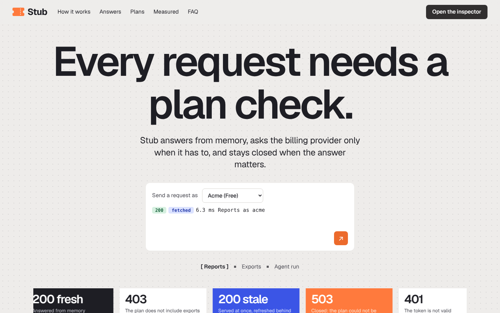
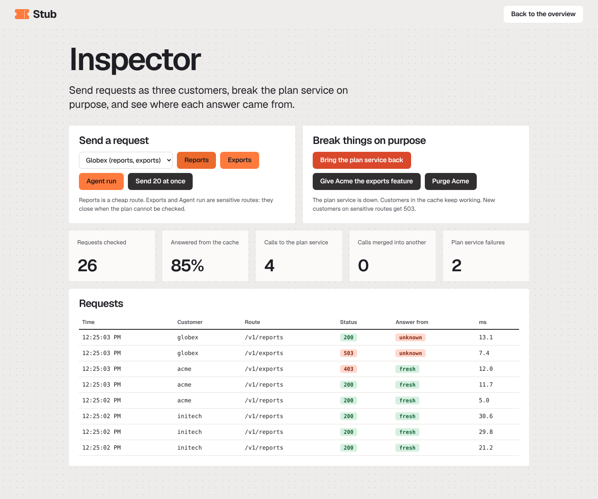
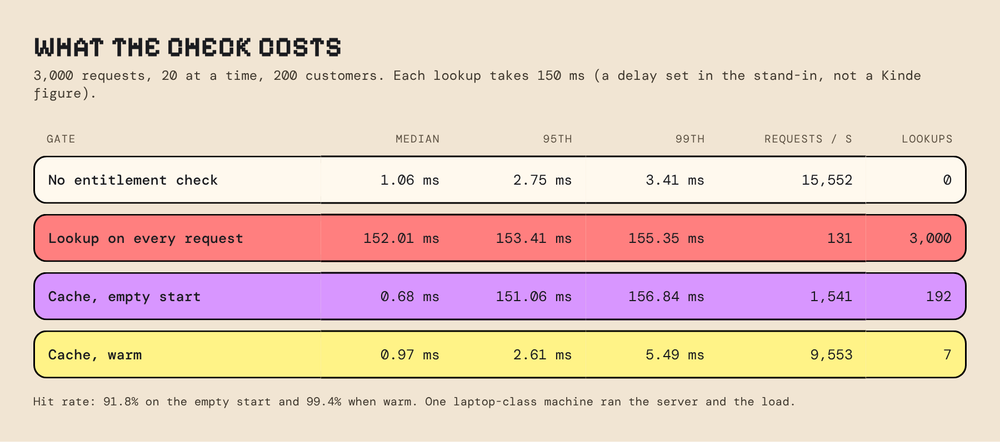
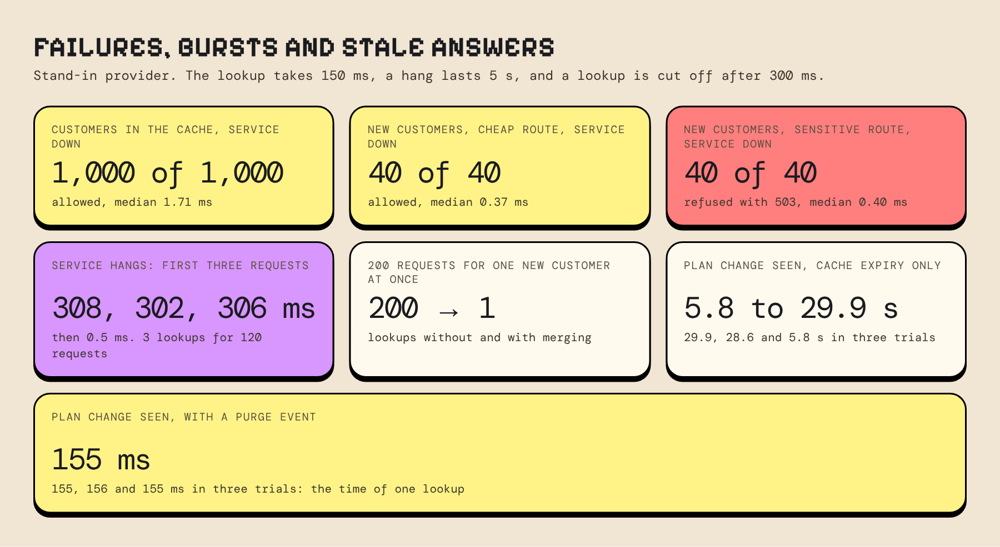

<h1 align="center">Stub</h1>

<p align="center">
  An access check that costs about a millisecond.<br>
  Stub checks a customer's plan on every request, without asking the billing provider every time.
</p>

<p align="center">
  <a href="LICENSE"></a>
  
  
  
  
</p>

## What Stub is

Stub is a small gateway that decides, for each request, whether the caller's plan includes the feature the route needs. It is built to show one production problem: **how to keep an access check inside a latency budget** when the answer lives in a billing provider.

- **The token is checked on the server.** Stub verifies the signature, issuer and expiry with Kinde's public keys. This makes no network call per request.
- **Plan entitlements are cached.** A Kinde access token lasts 24 hours by default, and the docs list no billing entitlements claim in it. So Stub reads entitlements from the Kinde Management API and keeps them in memory.
- **Answers are fresh for 30 seconds,** and stale answers are served for up to 5 minutes while a refresh runs behind them.
- **Simultaneous lookups are merged.** 200 requests for one new customer make one call to Kinde.
- **A plan-change event purges the customer,** so the gateway sees the change in one lookup and not after the cache expires.
- **Failure behavior is set for each route.** When the plan cannot be checked, a cheap route lets the request through and a sensitive route returns 503. A timeout and a breaker stop one slow provider from slowing every request.

## What it looks like

The overview page lets you send a request as three demo customers. The inspector page lets you take the plan service down, change a plan and purge a customer.





## Measured results

The numbers below come from the stand-in provider, with a lookup delay of 150 ms that I set. They are not Kinde latency. Run `bun scripts/bench.ts perf` to repeat them on your machine.





## Run it

You need [Bun](https://bun.sh).

```bash
bun install
bun run dev
```

Open <http://localhost:3100> for the overview, or <http://localhost:3100/app> for the inspector. With no settings, Stub uses a stand-in for Kinde and makes its own test tokens, so you need no account.

```bash
bun test                       # 25 tests
bun scripts/bench.ts burst     # 200 requests for one new customer, with and without merging
bun scripts/bench.ts perf      # latency of four gate modes
bun scripts/bench.ts down      # the plan service is down
bun scripts/bench.ts slow      # the plan service hangs
bun scripts/bench.ts stale     # how long a plan change stays hidden (about 3 minutes)
```

## Use it with Kinde

Copy `.env.example` to `.env.local` and set:

```
PROVIDER=kinde
KINDE_DOMAIN=https://yourbusiness.kinde.com
KINDE_M2M_CLIENT_ID=...
KINDE_M2M_CLIENT_SECRET=...
```

The machine-to-machine app needs the `read:billing_entitlements` scope. The Kinde path has not been run against a live account yet. It is built from the Kinde API reference, and the tests use the stand-in.

## How it is laid out

| File | What it holds |
| --- | --- |
| `src/core.ts` | The rules that need no network: how old an answer is, the access decision, how Kinde's answer is read |
| `src/cache.ts` | The cache: merged lookups, stale answers, timeout, breaker, purge |
| `src/providers.ts` | The Kinde provider and the stand-in |
| `src/auth.ts` | Local token check |
| `src/app.ts` | The Hono app, the route table and the webhook |
| `src/server.ts` | Settings and start-up |
| `src/web/` | The overview page, the inspector page, styles and the logo |
| `scripts/bench.ts` | The measurements |

## Limits

- The measurements use a stand-in provider with a fixed delay. A real Kinde lookup will take a different time.
- One process holds the cache. With several instances, each keeps its own cache, and a purge reaches only the instance that received the event.
- The webhook route reads the customer from the event with a guess at its shape. If the shape differs, it purges everything, which is safe but slower.
- Kinde's entitlements endpoint takes the billing customer ID and returns a 500 for an organization code, so Stub reads the mapping from `customers.json`. Fill that file in when you create each customer.

## Licence

MIT
